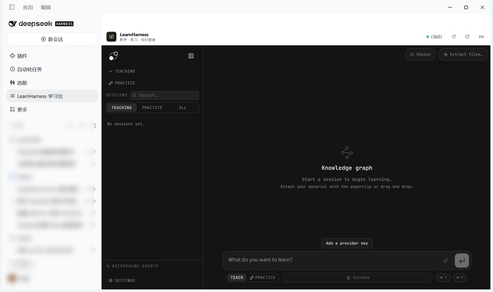

# LearnHarness for DeepSeek Harness

把 [LearnHarness](https://github.com/amosblomqvist/learnharness) 完整接进 DeepSeek Harness：
左侧边栏常驻「LearnHarness 学习台」，点开即为完整的学习工作台。



这不是重写的简化版。教学、练习、知识图谱、资料导入、模型设置、听写、会话恢复和后台
代理仍由上游 Next.js 应用提供；本插件负责启动并守护它的本地生产服务器，再把完整界面
放进 Harness 主面板。

## 界面

- `sidebar.panellist`：左侧边栏学习台图标，默认固定，可从侧边栏「更多」取消/恢复固定。
- `main`：主面板 `learnharness`，内嵌完整 LearnHarness。
- `sidebar.footer.action`：只在发现上游更新时出现的左下角「更新」按钮。
- 顶栏：运行状态、更新入口、重载、在新标签页打开、语言切换。
- 未运行：启动按钮、重试、服务日志、本地数据目录。

## 语言

- 插件外壳、侧边栏入口、启动/更新提示默认中文。
- 顶栏右侧 `EN / 中` 切换中英文，选择记录在浏览器 localStorage。
- 插件元数据同时提供 `locale/zh.json` 与 `locale/en.json`。
- LearnHarness 上游应用本身目前没有 i18n，嵌入的课堂界面仍是英文；本插件翻译的是
  Harness 宿主外壳和更新流程。

## 组成

| 半边 | 文件 | 作用 |
| --- | --- | --- |
| Host | `index.js` | 守护 `next start`；检查上游提交；执行拉取、重建、重启与回滚；提供 `/learnharness/*` 控制路由 |
| Client | `client.js` | 注册学习台图标、主面板和左下角更新按钮；中英文、状态轮询、更新进度 |
| 文案 | `locale/*.json` | 插件列表里的中英文标题与描述 |
| 图标 | `icon.svg` | 原创建图标：打开的书 + 一点火花 |
| 构建助手 | `scripts/*.mjs` + `build-app.ps1` | 修补、清理、构建 LearnHarness |

## 安装

在 Harness 里让 Agent 执行：

```text
plugin_manager install_bundle
target: D:\Github\My-Plugins\dsh-learnharness
```

安装后左侧边栏立即出现「LearnHarness 学习台」。Host 同时开始预热本地服务；打开面板时
通常已经就绪。

## 构建 LearnHarness

本机已有一个可用的生产构建（`D:\Github\learnharness\.next\BUILD_ID`）。如果重新 clone
或升级了上游源码，执行：

```powershell
powershell -ExecutionPolicy Bypass -File D:\Github\My-Plugins\dsh-learnharness\scripts\build-app.ps1
```

脚本会：

1. 如果缺少 `node_modules`，用 `npm_config_os=win32`、`npm_config_cpu=x64` 执行 `npm ci`
   （本机 npm 全局配置是 `os=linux`，不覆盖会装上错误的原生模块）；
2. 把 `lightningcss` 的 Windows 原生绑定放到 Turbopack 的 Node 池能找到的位置；
3. 安全删除 `.next`：Next 会把外部包做成 junction，普通递归删除会跟着 junction 把真实
   `node_modules` 里的包清空；
4. 设置 `LH_WEB_SERVER=1` 并执行 `npm run build`，跳过只在桌面打包时需要的 standalone
   追踪，避免 Next 在 Windows 上扫描整个项目。

手动等价命令：

```powershell
cd D:\Github\learnharness
$env:npm_config_os = 'win32'; $env:npm_config_cpu = 'x64'
npm ci --no-audit --no-fund
node D:\Github\My-Plugins\dsh-learnharness\scripts\prepare-app.mjs .
node D:\Github\My-Plugins\dsh-learnharness\scripts\patch-lightningcss.mjs .
node D:\Github\My-Plugins\dsh-learnharness\scripts\clean-next.mjs .
$env:LH_WEB_SERVER = '1'
npm run build
```

上游源码上为了接入而做的两处小改动由 `prepare-app.mjs` 自动维护：

- `app/layout.tsx`：把 `next/font/google` 换成 `app/fonts/` 下的同款 OFL 可变字体
  （JetBrains Mono、Source Sans 3），构建时不再访问字体 CDN；视觉不变。
- `next.config.ts`：`LH_WEB_SERVER=1` 时输出普通 `.next` 而非 standalone，供 `next start`。

## 上游自动更新

插件启动 12 秒后检查一次上游，此后每 30 分钟检查一次 `origin/main`：

- 发现新提交时，左侧边栏底部出现「更新」按钮，主面板顶栏也出现更新入口。
- 点击后自动执行：停止本地服务 → 备份 `.next` → 暂存两处受管源码改动 → `git pull --ff-only`
  → 重新应用字体/构建补丁 → 必要时 `npm ci` → 重新构建 → 重启服务。
- 构建失败会自动回滚源码、`node_modules` 和上一个 `.next`，然后恢复旧服务。
- 更新过程在主面板显示阶段和日志；成功后自动重新加载学习空间。

安全检查：

- 如果有受管文件之外的未提交改动，更新会停止并列出冲突文件，不会覆盖用户改动。
- 只处理快进更新；如果出现分叉，会失败并保留当前版本。
- 更新日志：`%USERPROFILE%\.dsh\learnharness\logs\update.log`。

控制路由：

- `GET /learnharness/update/status`
- `POST /learnharness/update/check`
- `POST /learnharness/update`
- `GET /learnharness/update/log`

## 数据与密钥

默认与 Harness 的其他本地状态放在一起：

- 学习记录：`%USERPROFILE%\.dsh\learnharness\data`
- 密钥：`%USERPROFILE%\.dsh\learnharness\auth.json`
- 服务日志：`%USERPROFILE%\.dsh\learnharness\logs\server.log`

这是独立的一份 LearnHarness 配置。第一次进入后，需要在 LearnHarness 的
**Settings → Providers** 里配置模型（Strong / Cheap / Vision），它不会自动复用
DeepSeek Harness 的模型密钥。

环境变量：

| 变量 | 作用 |
| --- | --- |
| `DSH_LEARNHARNESS_ROOT` | LearnHarness 应用根目录 |
| `DSH_LEARNHARNESS_DATA` | 数据根目录（其下自动创建 `data/` 和 `auth.json`） |
| `DSH_LEARNHARNESS_PORT` | 首选端口，默认 `3477`，占用时自动向后找 |
| `DSH_LEARNHARNESS_NODE` | 启动本地服务的 Node 可执行文件 |

## 生命周期

- 只监听 `127.0.0.1`，不对外网暴露。
- Host 加载时自动启动；服务就绪前面板显示启动进度。
- 插件卸载/重载时，只结束后台由本插件启动的进程；外部已在运行的同源服务会被复用。
- 控制路由：`GET /learnharness/status`、`POST /learnharness/start`、
  `POST /learnharness/restart`、`GET /learnharness/log`。
- 构建产物优先使用 `.next/standalone/server.js`；没有时使用 `next start`。

## 已知限制

- LearnHarness 在 iframe 中保留自己的主题和外观，不跟随 Harness 的明暗主题。
- 插件外壳支持中英文；上游 LearnHarness 应用本身尚未提供 i18n，课堂界面保持英文。
- 桌面版的 ChatGPT / Copilot / Grok 订阅桥接属于 Electron 主进程；浏览器模式仍支持网页版
  订阅连接，但不会走桌面主进程的私有凭据通道。
- 完整功能依赖上游应用的模型配置；本插件不代理或转售任何模型。
- 自动更新假设 LearnHarness 应用目录是受管 checkout；受管文件之外的本地改动会阻止更新。

## 许可与归属

LearnHarness 由 Amos Blomqvist 及贡献者开发，以 AGPL-3.0 发布。本插件只做宿主集成；
原始应用及其界面、图标和文档的版权归上游项目所有。`app/fonts/` 下的文件使用 SIL Open
Font License，许可证文本随字体一起放在该目录。

